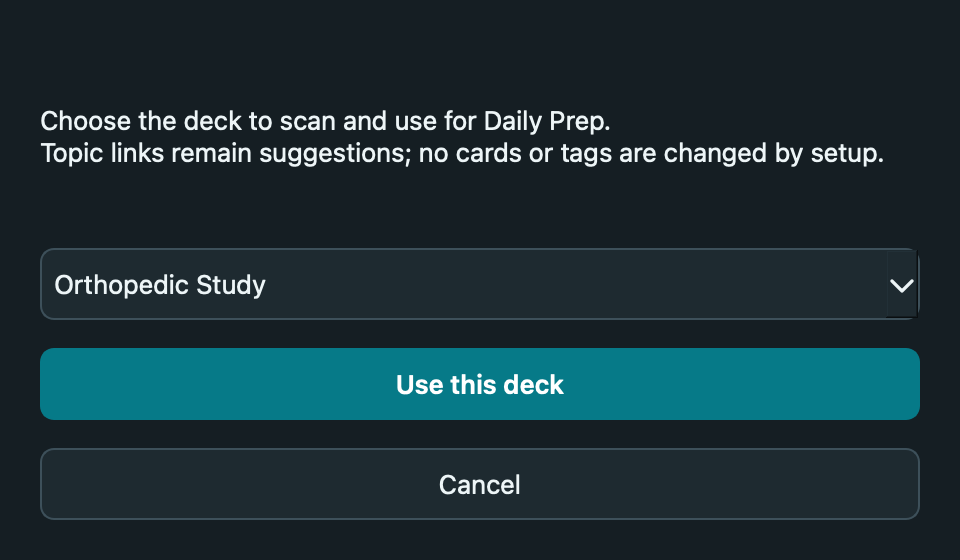
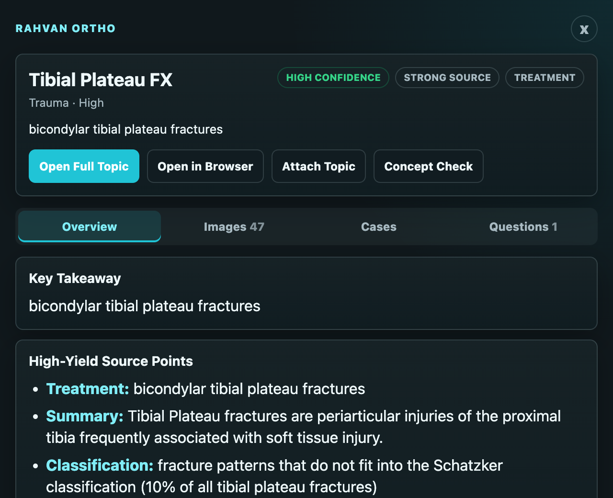
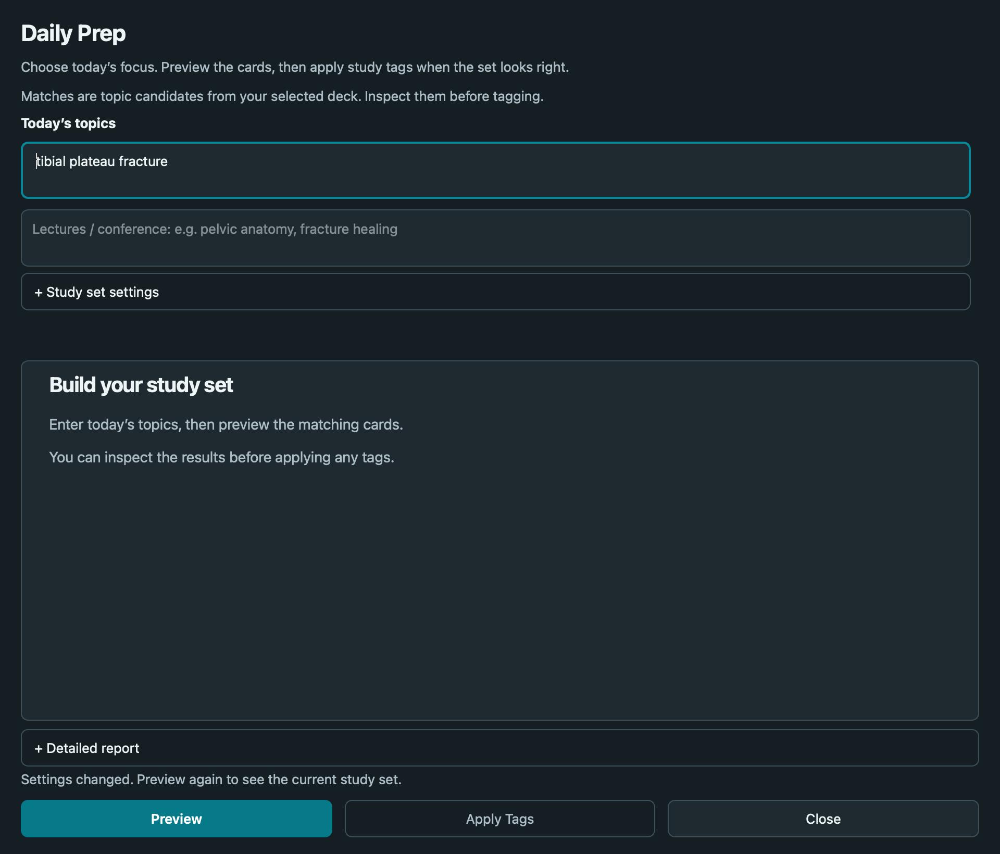

# Rahvan Ortho

Version **0.1.0-beta.4** · By **Rahvan** · October 19, 2026

Source context and focused case or lecture preparation for your orthopedic Anki cards.

## Install and choose your deck

1. Open **Tools → Add-ons → Get Add-ons** in desktop Anki and enter **1699391455**.
2. Fully quit and reopen Anki.
3. Open **Rahvan Ortho → Choose Study Deck** and select your orthopedic deck. Repeat this choice in each profile.
4. Review a card and use the **Rahvan Ortho** toolbar button or **Rahvan Ortho → Open Context Panel**.

[Install from AnkiWeb](https://ankiweb.net/shared/info/1699391455) · [Support](https://github.com/shadingtons/orthobullets-context/issues)

## Study tools

- Suggested topic links, source context and term popups.
- **Concept Check** uses the current cloze or Question/Answer target. Image cards and unsupported templates use comparison with the original card answer. Text feedback checks literal answer words; it does not grade clinical reasoning.
- **Daily Prep → Build Daily Prep Tag** finds candidates in your selected deck. Inspect **Preview**, then choose **Apply Tags** if the selection fits.
- Embedded topic pages, cancellable background searches, local feedback and persistent profile-specific source browser sessions.

Topic matches and excerpts are study suggestions. Confirm the full source and clinical context. No deck, personal reviewed-card inventory, HY shortlist or card-ID procedure preset is bundled. Your own orthopedic deck determines the results.

Screenshots use disposable demo cards, with no personal collection or tag writes.

## Compatibility and updates

Tested on **Anki 25.09.4 on macOS**. The download remains restricted to that Anki version. Windows/Linux are not yet validated; native add-ons run in desktop Anki. Deck cards are separate from the add-on.

Use Anki’s add-on update function, then fully quit and restart. This release keeps the existing AnkiWeb code and package identity. Configuration and local user files are preserved. Upgrading from the previous public release does not require selecting the same deck again. Switching from an older personal/private edition requires a new study-deck choice; those editions’ local data are not copied automatically.

## Cards and privacy

Setup, topic matching and previews do not change note fields or scheduling. **Apply Tags** writes the previewed note tags, shared by sibling cards. **Attach** is a separate field/tag action. No automatic unsuspension or sync occurs.

Searches send extracted topic phrases to Orthobullets; embedded source pages contact that publisher. Cached reference content, feedback and operation journals stay local. No telemetry or external AI service is used. A cancelled in-flight request may finish, but its completion is suppressed and further batch work stops.

## Help

Use the support link with Anki/OS/add-on versions and reproduction steps. If a tag operation has an uncertain result or pending journal, preserve it and inspect the result before retrying. Do not post private collections, user files, journals, credentials or identifying screenshots.

Software by **Rahvan**, under **AGPL-3.0-or-later**. The package includes source, license, tests and reproducible build instructions. Article references and excerpts are credited to **Orthobullets** and retain their separate rights. This is an independent Rahvan add-on.
